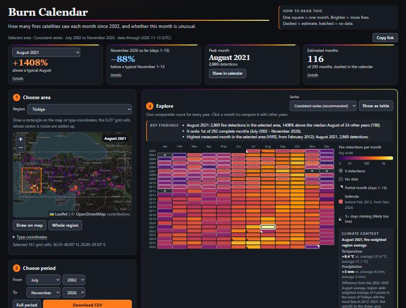

# Yolcular: Burn Calendar

NASA Space Apps Challenge 2026, Challenge #8. A web app that turns NASA FIRMS MODIS and VIIRS fire detections into one comparable monthly series since July 2002, shown as a burn calendar that tells you whether this month is unusual.

- **Live site:** https://meceylan.github.io/yolcular/
- **Example view** (Aegean and Mediterranean coast of Türkiye, August 2021): https://meceylan.github.io/yolcular/?region=turkiye&box=36.5,26,40,29.5&ym=2021-08



## What it does

- Pick a region (Türkiye, Balkans, Caucasus, Eastern Mediterranean, California, Amazon arc, Southeast Australia) or draw a rectangle on the map, and choose a period.
- One square per month, brighter means more fire detections. Dashed squares are estimates, hatched squares have no data.
- Compares the chosen month with the median of the same month in other years, with a fire-density map layer, key findings, temperature and rainfall context (NASA POWER), a share link, and a CSV download.

## Method in short

VIIRS (since 2012) sees several times more fires than MODIS (since 2002), so raw counts cannot be compared across the two. For each region and each calendar month, a factor = sum of VIIRS detections / sum of MODIS detections over 2012–2022. Before February 2012 the series is MODIS × factor (an estimate, marked as such); from February 2012 it is the VIIRS S-NPP count itself; from November 2026 it is VIIRS NOAA-20 × 0.986. Full description, filters and limits: [docs/method.md](docs/method.md).

## Validation

Each year of 2012–2022 is left out in turn and predicted from the others; 2023–2025 is an independent test. Details: [docs/validation.md](docs/validation.md), [docs/validation_s2.md](docs/validation_s2.md), [docs/validation_s3.md](docs/validation_s3.md).

| Region | Monthly error | Yearly error (mean) | Worst year | 2023–2025 total |
|---|---|---|---|---|
| Türkiye | 11.8% | 4.6% | 11.3% | +1.5% |
| Balkans box | 8.7% | 3.1% | 5.2% | +3.8% |
| Caucasus box | 12.0% | 5.5% | 16.6% (2015) | +0.7% |
| Eastern Mediterranean box (experimental) | 23.7% | 15.4% | 43.6% (2020) | +18.7% |
| California box | 10.2% | 7.3% | 18.4% (2016) | 0.0% |
| Amazon arc box | 6.8% | 2.5% | 10.0% (2021) | −0.3% |
| Southeast Australia box (experimental) | 14.6% | 12.1% | 36.0% (2012) | +8.2% |

Values before 2012 are estimates. Experimental regions are rougher; the page says so.

## Data and acknowledgments

- **NASA FIRMS**, MODIS Collection 6.1 and VIIRS 375 m active fire data (archive download and API), https://firms.modaps.eosdis.nasa.gov.
  > We acknowledge the use of data and/or imagery from NASA's Fire Information for Resource Management System (FIRMS) (https://earthdata.nasa.gov/firms), part of NASA's Land, Atmosphere Near real-time Capability for Earth observations (LANCE) (https://earthdata.nasa.gov/lance) and NASA's Earth Science Data and Information System (ESDIS).

  FIRMS data are provided "as is"; not for tactical decisions. Disclaimer: https://firms.modaps.eosdis.nasa.gov/download/Readme.txt
- **NASA POWER** monthly temperature and precipitation, https://power.larc.nasa.gov (context only; no claim of cause).
- **Natural Earth** 1:10m country and land polygons (public domain), https://www.naturalearthdata.com.
- Leaflet 1.9.4 and OpenStreetMap tiles (© OpenStreetMap contributors); inferno colour map (matplotlib, CC0).

Full list with licences: [docs/references.md](docs/references.md).

## Accessibility

Colour scale checked for grayscale and three colour-vision types, with contrast checks for text, controls, focus ring and calendar marks (`python scripts/check_a11y.py`, report in [docs/accessibility.md](docs/accessibility.md)). The calendar is an ARIA grid with full keyboard control and a table view, charts have text summaries, motion respects `prefers-reduced-motion`. A manual test with a screen reader (NVDA) has not been done; only the automated and scripted checks above were run.

## Run it yourself

Needs Python 3 and a free FIRMS MAP_KEY (https://firms.modaps.eosdis.nasa.gov/api/map_key/).

```bash
# create a file named .env containing one line: FIRMS_MAP_KEY=your_key   (never commit it)
python scripts/fetch.py --region turkiye --preset s1
python scripts/clean.py --region turkiye
python scripts/grid.py --region turkiye
python scripts/harmonize.py --region turkiye
python scripts/export.py --region turkiye
python -m http.server 8000 --directory web
```

The 2012–2025 archive files come from the FIRMS Archive Download page (see [docs/archive_files.md](docs/archive_files.md)); the API commands above fill the rest. Regions are defined in `data/regions.json`. Raw and processed data are not in git; the page reads precomputed JSON from `web/data/`. The MAP_KEY is read from the environment and never appears on the page.

## AI assistance

This project was developed with Claude and Claude Code (Anthropic): code, data processing scripts, analysis notes and documentation were generated with AI assistance, and code files carry an "AI-assisted" header. The method, the decisions (which regions, filters, how to label estimates) and the responsibility for the result belong to the team, who reviewed and tested the output. This follows the Space Apps rule on disclosing the use of artificial intelligence.

Built by team Yolcular for NASA Space Apps Challenge 2026. No NASA logo is used; this project is not affiliated with or endorsed by NASA.
