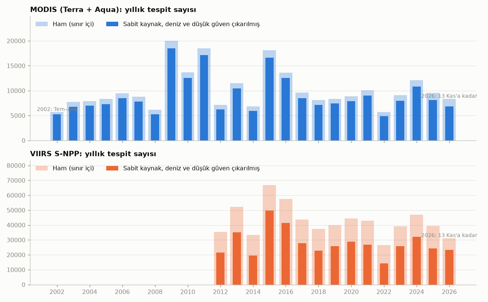
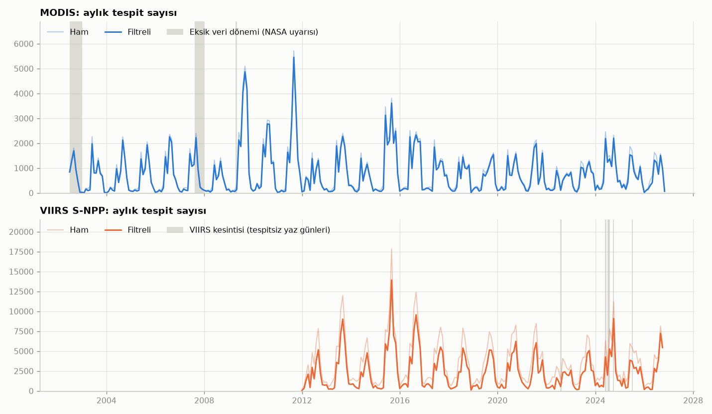
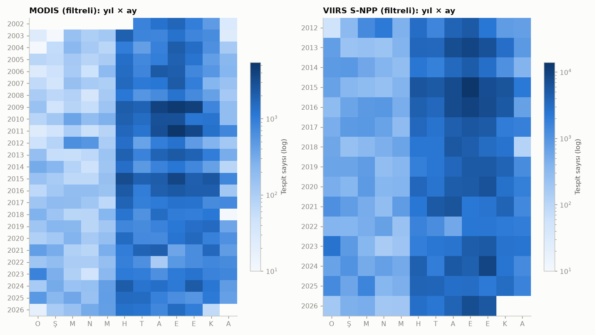
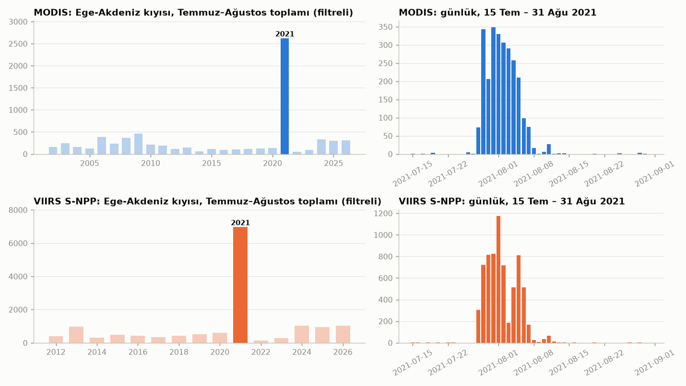
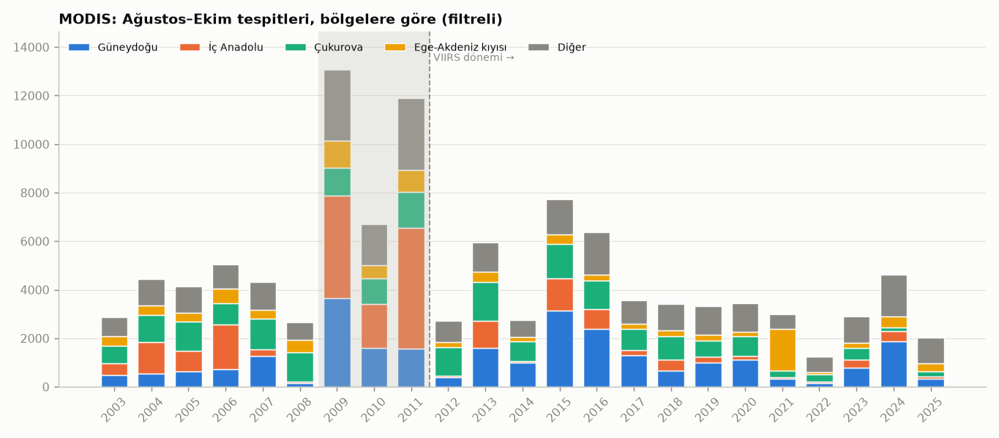
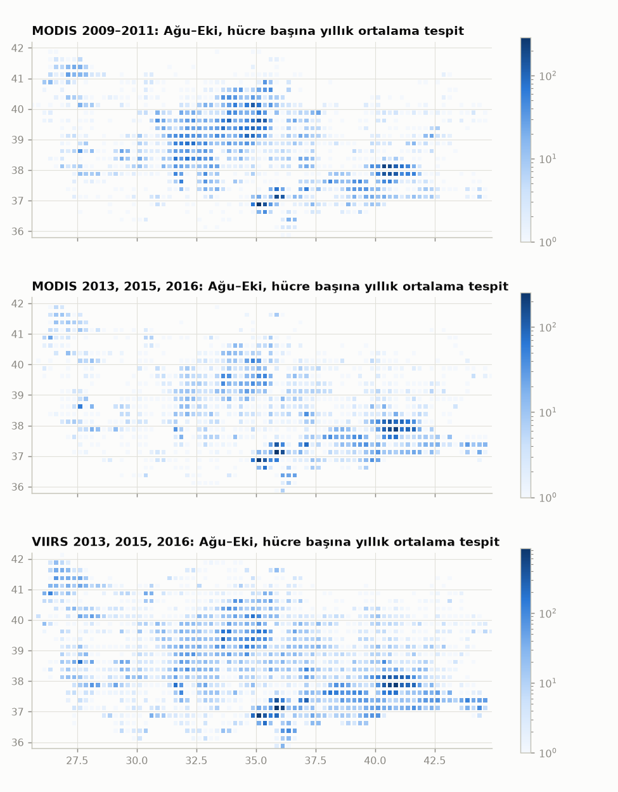
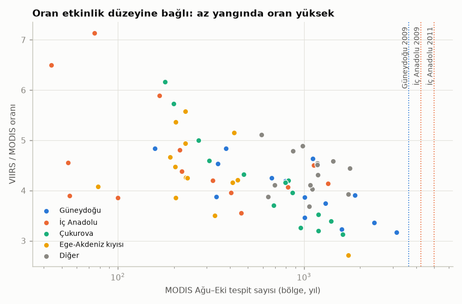

# Veri kontrol raporu (adım 23)

Tarih: 14 Kasım 2026. Betik: `scripts/data_report.py --region turkiye`. Sayılar: `docs/data_report_stats.json`. Girdi: `data/processed/turkiye/detections.parquet` (Türkiye sınırı içindeki satırlar).
"Filtreli" = sabit kaynak (`type` 1/2), deniz (`type` 3) ve düşük güven çıkarılmış. Bu, adım 28'in kararı değil, yalnızca bu raporda kullanılan deneme filtresidir.

## Özet
1. **Veri sağlam.** Bilinen olay (2021 yazı Akdeniz/Ege yangınları) iki sensörde de çok net görünüyor. Kopya satır yok. API'den gelen veri ile arşiv aynı.
2. **MODIS 2009–2011 fazlalığı veri hatası değil, gerçek yangın etkinliği;** büyük olasılıkla hasat sonrası anız yakma. Filtreler farkı değiştirmiyor.
3. **Harmonizasyon için risk:** 2009 ve 2011'de İç Anadolu'daki etkinlik, VIIRS döneminde görülen en yüksek düzeyin 3–4 katı. Katsayı bu düzeyde hiç sınanmadı; o yılların tahmini daha belirsiz.
4. Yeni boşluklar bulundu: Aqua (2002 ve 2020) ve S-NPP (2026). `docs/data_gaps.md` güncellendi.

## 1. Yıllık ve aylık sayılar

- MODIS yılda 5 700–20 000, VIIRS S-NPP 26 600–66 800 tespit (ham, sınır içi). 2002 yarım yıl (Temmuz'dan), 2026 13 Kasım'a kadar.
- İki sensör aynı yılları yüksek ve düşük gösteriyor (2015 ikisinde de en yüksek, 2022 ikisinde de en düşük). Yıllık filtreli VIIRS/MODIS oranı 2012–2025 boyunca 2,9–3,7 arasında, yani oldukça kararlı.
- Mevsim deseni her yıl aynı: Haziran'da bir tepe (hasat), Ağustos–Ekim'de ikinci ve daha büyük tepe, kışın çok az tespit.
- Filtre MODIS'te yılda %8–12, VIIRS'te %30–45 satır çıkarıyor (VIIRS sabit kaynakları çok daha fazla görüyor).
- 2022 gerçekten sakin bir yıl: Ağustos 2022'de MODIS'te 29 gün veri var ama yalnızca 107 tespit. Veri kesintisi değil.

## 2. Boşluk günleri
Grafikte gri bantlar `docs/data_gaps.md` içindeki dönemlerdir.

| Sensör | Dönem | Bulgu |
|---|---|---|
| MODIS | 2002 Tem–Ara (NASA uyarısı) | Temmuz–Ekim'de tümüyle tespitsiz gün yok. Ancak **Aqua 30 Tem – 7 Ağu 2002 arasında 9 gün boş**; o günlerde yalnızca Terra var |
| MODIS | 2007 Ağu ortasından (NASA uyarısı) | 15 Ağu – 31 Eki arasında tümüyle tespitsiz gün yok. Eksik parçalar gün içinde olabilir; sayımdan görülemiyor |
| MODIS | 21–22 Nisan 2009 | İki günde toplam 6 tespit; Nisan zaten sakin ay, seriye etkisi yok |
| MODIS | 30 Ağu – 2 Eyl 2020 | **Yeni:** Aqua 4 gün boş (Terra var) |
| MODIS | 28–29 Eyl 2014 | İki sensör birden 2 gün tespitsiz; yaz aylarında 2 günü aşan başka boşluk yok |
| VIIRS S-NPP | 2022-07-27 – 08-10 (15 gün), 2024'te dört kesinti, 2025-07-06/07 | `data_gaps.md` ile aynı, doğrulandı |
| VIIRS S-NPP | 1–2 Haz 2026 ve 11–16 Tem 2026 | **Yeni:** uydunun son aylarında iki kesinti daha |

Kışın tespitsiz günler boşluk sayılmadı (MODIS'te yılda 25–75 gün, çoğu Kasım–Mayıs).

## 3. Bilinen olay: 2021 yazı Akdeniz/Ege yangınları

Ege-Akdeniz kıyı kutusu (36–38,6 K, 27–32,5 D), Temmuz–Ağustos, filtreli:

| | 2021 | Diğer yılların medyanı | Kat |
|---|---|---|---|
| MODIS tespit | 2 625 | 142 | 18× |
| VIIRS tespit | 6 975 | 425 | 16× |
| MODIS FRP toplamı | 397 000 MW | 6 950 MW | 57× |

- Tespitlerin neredeyse tamamı 28 Temmuz – 12 Ağustos arasında (MODIS 2 591, VIIRS 6 885). Tepe günü MODIS'te 31 Temmuz, VIIRS'te 1 Ağustos. Manavgat ve Muğla yangınlarının tarihleriyle örtüşüyor.
- 2021, iki sensörde de bu bölgenin açık ara en yüksek yılı.
- **Demo için not:** Bu pik ülke toplamında görünmüyor (Ağustos 2021 Türkiye toplamı sıradan), çünkü tarım yangınları sayıca çok daha fazla. Pik yalnızca bölge seçilince ortaya çıkıyor; bölge seçimi özelliğinin en iyi örneği bu.

## 4. MODIS 2009–2011 neden yüksek?

### Fark nerede
- Yıllık ortalama (ham): 2009–2011'de 17 366, 2012–2025'te 9 894 (1,76 kat).
- Fazlalığın tamamı **Ağustos–Ekim**'de. Yılın geri kalanı aynı düzeyde (filtreli 5 496'ya karşı 5 016).
- Bölgelere göre Ağustos–Ekim ortalaması (filtreli MODIS):

| Bölge | 2009–2011 ort. | 2012–2025 ort. | 2012–2025 en yüksek |
|---|---|---|---|
| İç Anadolu | 3 677 | 386 | 1 342 (2015) |
| Güneydoğu | 2 265 | 1 150 | 3 133 (2015) |
| Diğer | 2 525 | 1 107 | 1 764 (2016) |
| Çukurova | 1 231 | 782 | 1 609 (2013) |
| Ege-Akdeniz kıyısı | 858 | 367 | 1 726 (2021) |

Güneydoğu'daki 2009 düzeyi (3 652) VIIRS döneminde de görülmüş (2015: 3 133). **Olağan dışı olan İç Anadolu:** 2009'da 4 231, 2011'de 4 984; sonraki en yüksek yılın 3–4 katı. 2010 daha ılımlı.

### Veri hatası mı? Hayır
| Kontrol | Sonuç |
|---|---|
| Kopya satır | 0 |
| API verisi arşivle aynı mı (2002–2011 API'den, 2012+ arşivden geldiği için) | 2013 ve 2015'ten iki 5 günlük parça API'den yeniden çekildi: arşivdeki 1 412 satırın tamamı API'de birebir var |
| Tespit nitelikleri (FRP, Terra/Aqua payı, yüksek güven payı, tarama açısı) | 2009–2011, VIIRS dönemindeki yoğun yıllarla (2013, 2015, 2016) aynı: FRP medyanı 20,4'e karşı 19,3 MW; Terra payı %54'e karşı %53; yüksek güven %31'e karşı %30 |
| Yangınlı gün sayısı | Aynı (yılda ~90 gün): fazlalık birkaç bozuk günden değil, mevsim boyunca yayılmış |
| Yer | 2009–2011 haritası, sonraki yoğun yılların MODIS ve VIIRS haritasıyla aynı tarım ovalarını gösteriyor (hücre korelasyonu 0,81 ve 0,82) |

Tek fark gece payı (%21'e karşı %14); akşam yakılan tarlalarla uyumlu, hata belirtisi değil.

### Filtreler farkı değiştiriyor mu? Hayır
| Filtre | 2009–2011 ort. | 2012–2025 ort. | Oran |
|---|---|---|---|
| Ham | 17 366 | 9 894 | 1,76 |
| Sabit kaynak ve deniz çıkarılmış | 16 575 | 9 137 | 1,81 |
| Düşük güven de çıkarılmış | 16 051 | 8 809 | 1,82 |
| Yalnızca yüksek güven | 4 452 | 2 239 | 1,99 |
| Yalnızca gündüz | 12 856 | 7 226 | 1,78 |

Sabit kaynak sayısı yıldan yıla neredeyse sabit (MODIS'te yılda 650–950), dolayısıyla fazlalığı açıklamıyor. Filtre sıkılaştıkça fark azalmıyor, hafifçe artıyor.

### VIIRS dönemiyle karşılaştırma
- 2012–2025'te de yüksek yıllar var (2013, 2015, 2016, 2024) ve **VIIRS bu yılları MODIS ile birlikte yüksek gösteriyor.** Yani MODIS'in bu bölgelerde ve aylarda yüksek sayı vermesi bağımsız bir sensörle doğrulanmış bir davranış.
- 2009–2011 için VIIRS yok, bu yüzden doğrudan doğrulama mümkün değil. Elimizdeki kanıt dolaylı: aynı yerler, aynı aylar, aynı tespit nitelikleri.

### Sonuç
Gerçek etkinlik; yer (tahıl ovaları), zaman (hasat sonrası) ve küçük, kısa ömürlü yangın profili **anız yakmayı** gösteriyor. Arazi örtüsü verisi kullanmadığımız için "tarım yangını" bir çıkarımdır, kanıt değildir. 2012 sonrasındaki düşüş gerçek bir değişime işaret ediyor; nedeni (denetim, hava koşulları, ekim deseni) bu verinin söyleyebileceği bir şey değil.

## 5. Harmonizasyona etkisi (adım 28–32)

VIIRS/MODIS oranı sabit değil, **etkinlik düzeyine bağlı**: az yangınlı bölge-yıllarda 5–7, çok yangınlı olanlarda 3–3,5. (VIIRS küçük yangınları da görüyor; yangın azken bunların payı büyüyor.)

- **Adım 28 (filtre):** Bu bulgu filtre seçimini etkilemiyor; 2009–2011 hiçbir filtreyle "düzelmez" ve düzeltilmemeli. Sabit kaynak sayısının yıllar içinde sabit kalması, NRT için arşivden konum maskesi fikrini destekliyor.
- **Adım 30 (örtüşme):** Oranı yalnızca bölge ve aya göre değil, etkinlik düzeyine göre de incele. `data_gaps.md` günlerini dışarıda tut (Aqua 2020 ve S-NPP 2026 kesintileri dahil).
- **Adım 31 (katsayı):** Katsayıyı "yıllık oranların ortalaması" olarak değil, **"toplamların oranı"** olarak hesapla (ΣVIIRS / ΣMODIS). Ortalama, az yangınlı yılların yüksek oranlarını fazla tartar ve 2009–2011'i olduğundan büyük gösterir (İç Anadolu, Ağu–Eki: 4,67'ye karşı 4,29). Oranın düzeye bağlılığı güçlü çıkarsa basit bir düzey düzeltmesi düşünülebilir, ama yöntem açıklanabilir kalmalı.
- **Adım 31–32 (belirsizlik):** İç Anadolu 2009 ve 2011, katsayının hesaplandığı aralığın dışında (en yüksek sınanmış düzeyin 3–4 katı). Bu aylar için tahmin bir dış değerlemedir; büyük olasılıkla biraz fazla tahmin edilir. Yöntem bölümünde açıkça yazılmalı.
- **Adım 32 (doğrulama):** Uyumlu seride 2009 ve 2011 Ağustos–Ekim en yüksek değerler olacak. Bu bir kopukluk ya da hata değil; grafikte ve sayfada bir cümleyle açıklanmalı. 2011→2012 geçişindeki düşüş sensör değişiminden değil, MODIS'in kendi içinde de görülen gerçek düşüşten kaynaklanıyor.
- **2002:** Aqua'nın 30 Tem – 7 Ağu 2002 boşluğu, Ağustos 2002 tahminini bir miktar düşük gösterir (o günlerde tek uydu var).
