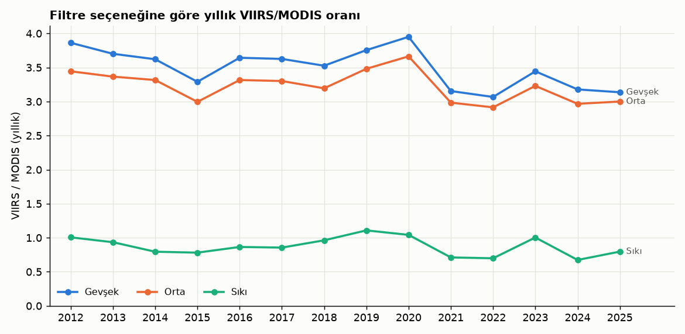

# Filtre kararı (adım 28)

**Durum: ONAYLANDI (14 Kasım 2026).** Seçilen filtre: Orta. Konum maskesi ve boşluk işareti de onaylandı.
Betik: `scripts/filter_options.py --region turkiye`. Sayılar: `docs/filter_stats.json`. Grafik: `docs/filter_ratio_by_year.png`.
Denemeler Türkiye sınırı içindeki satırlarla, iki sensörün birlikte ve arşiv kalitesinde bulunduğu 2012–2025 döneminde yapıldı (MODIS 138 521, VIIRS S-NPP 605 609 ham tespit).

## 1. Güven eşlemesi

| Ortak sınıf | MODIS (0–100) | VIIRS | Yangın tespitlerindeki pay: MODIS / VIIRS |
|---|---|---|---|
| düşük | 0–29 | `l` | %3,6 / %11,1 |
| normal | 30–79 | `n` | %71,9 / %82,9 |
| yüksek | 80–100 | `h` | %24,5 / %6,0 |

- Eşleme FIRMS'in kendi tanımıdır. İki sınıflandırma aynı şeyi ölçmüyor: "yüksek" MODIS'te her dört tespitten biri, VIIRS'te on altıda biri. Bu yüzden sınıflar yalnızca **düşük olanı atmak** için güvenle kullanılabilir; "yalnızca yüksek" iki sensörü karşılaştırılamaz hale getirir.
- VIIRS'te düşük güvenli tespitlerin tamamı gündüz (güneş parlaması riski); MODIS'te %78'i gündüz.
- MODIS eşiğini 30 yerine 20, 40 ya da 50 yapmak oranın yıldan yıla kararlılığını neredeyse hiç değiştirmiyor (değişkenlik %7,1 → %6,6), ama 50'de MODIS tespitlerinin %14'ü daha gidiyor. Standart 30 eşiği yeterli.

## 2. Üç seçenek

| Seçenek | Kural | MODIS kalan | VIIRS kalan | VIIRS/MODIS | Oranın yıllık değişkenliği | Aylık uyum (korelasyon) |
|---|---|---|---|---|---|---|
| Ham | Filtre yok | 138 521 (%100) | 605 609 (%100) | 4,37 | %8,9 (3,69–5,01) | 0,895 |
| Gevşek | Sabit kaynak ve deniz çıkar | 127 915 (%92) | 445 576 (%74) | 3,48 | %8,2 (3,07–3,95) | 0,907 |
| **Orta (öneri)** | Gevşek + düşük güveni çıkar | 123 320 (%89) | 395 942 (%65) | 3,21 | **%7,1** (2,91–3,66) | **0,919** |
| Sıkı | Gevşek + yalnızca yüksek güven | 31 346 (%23) | 26 651 (%4) | 0,85 | %15,8 (0,67–1,11) | 0,878 |

- Filtre sıkılaştıkça oran düşüyor, çünkü çıkarılanların çoğu VIIRS tespiti (sabit kaynakların büyük kısmını yalnızca VIIRS görüyor).
- Sıkı seçenekte MODIS'te 168 ayın 84'ünde 50'den az tespit kalıyor; takvim gürültüye boğulur ve oran iki kat oynak hale gelir.

## 3. Karar: Orta

**Kural:** `type` 1, 2 ve 3 olan tespitleri (yanardağ, sabit kara kaynağı, deniz) ve düşük güvenli tespitleri (MODIS < 30, VIIRS `l`) çıkar; geri kalan her şeyi tut. Gündüz ve gece birlikte sayılır.

**Neden ve risk:** Orta seçenek, iki sensörün birbirini en iyi izlediği seçenek: VIIRS/MODIS oranı yıldan yıla en az oynuyor (%7,1) ve aylık sayılar en yüksek uyumu gösteriyor (0,919). Sabit kaynakları çıkarmak zorunlu, çünkü VIIRS tespitlerinin dörtte biri yangın değil sanayi ve bunlar MODIS'te çok daha az görünüyor; düşük güveni çıkarmak ise küçük ama ölçülebilir bir iyileşme sağlıyor ve MODIS'in yalnızca %4'üne, VIIRS'in %8'ine mal oluyor. Sıkı seçenek veriyi %4–23'e indirip seriyi oynak hale getiriyor, gevşek seçenek ise gündüz güneş parlamalarını seride bırakıyor. Risk iki yönlü: düşük güvenli tespitlerin bir bölümü gerçek küçük yangınlardır (özellikle anız yakma), yani seri gerçek etkinliği bir miktar eksik sayar; öte yandan FIRMS'in `type` alanı kusursuz değildir, etiketlenmemiş bazı sanayi kaynakları seride kalır. İkisi de iki sensörü benzer yönde etkilediği için oranı ve dolayısıyla uyumlaştırmayı bozmaz, ama mutlak sayılar "tespit edilen yangın pikseli"dir, "yangın sayısı" değildir; sayfada böyle adlandırılmalı.

## 4. Sabit kaynak ve deniz

| Veri | Yöntem |
|---|---|
| Arşiv (SP), `type` dolu | `type` ∈ {1, 2, 3} çıkarılır |
| Güncel (NRT), `type` boş | Aşağıdaki **konum maskesi** uygulanır |

Deniz için ayrı bir kara maskesi gerekmiyor: tablo zaten Türkiye sınırıyla kesilmiş (`in_country`), açık deniz platformları `type` 3 ya da maske ile gidiyor.

### NRT için konum maskesi
- **Üretim:** Arşivdeki tüm `type` 2 ve 3 tespitleri (MODIS, S-NPP, NOAA-20; Temmuz 2026'ya kadar) 0,01° (yaklaşık 1 km) hücrelere atanır. Bir hücre, **en az 3 ayrı günde** sabit kaynak tespiti içeriyorsa maskeye girer. Sonuç: 1 518 hücre.
- **Uygulama:** NRT tespiti maskeli bir hücreye düşüyorsa çıkarılır. VIIRS için yalnızca kendi hücresi, MODIS için kendi hücresi ve 8 komşusu (MODIS'in konum hatası daha büyük).
- **Sınama** (maske 2024'e kadarki veriyle kuruldu, hiç görmediği 2025 ve 2026 Ocak–Temmuz verisinde denendi; doğru cevap `type` alanından biliniyor):

| | Yakalanan sabit kaynak | Yanlışlıkla çıkarılan yangın |
|---|---|---|
| VIIRS, 2025 | %97,4 | %3,8 |
| VIIRS, 2026 Oca–Tem | %94,9 | %6,3 |
| MODIS, 2025 | %79,4 | %5,6 |
| MODIS, 2026 Oca–Tem | %79,0 | %8,1 |

- Maskeyle üretilen aylık sayılar, `type` alanıyla üretilenlerin ortalama %95'i ve onlarla neredeyse aynı biçimde değişiyor (korelasyon 0,999). Yani maske uygulanan aylar (Ağustos 2026 ve sonrası) yaklaşık **%5 düşük** çıkar; iki sensörde aynı oranda olduğu için karşılaştırmayı bozmaz.
- Daha geniş maske (komşu hücreler VIIRS için de) sabit kaynakların %99'unu yakalıyor ama yangınların %9–14'ünü siliyor; daha dar maske (5 gün) MODIS'te %76'ya düşüyor. Seçilen ayar ikisinin ortası.
- Arşiv (SP) verisi geldikçe NRT ayları `type` ile yeniden üretilir; maske geçicidir.
- Yeni açılan bir tesis maskede olmaz. İleride gerekirse "aynı hücrede 30 gün içinde 5+ gün tespit" kuralı eklenebilir; şimdilik eklenmedi (basit kalsın).

## 5. Kasım 2026: oran neden 10?
1–13 Kasım 2026, sınır içi:

| | MODIS | VIIRS (NOAA-20) | Oran |
|---|---|---|---|
| Ham | 70 | 708 | 10,1 |
| Maske sonrası | 64 | 491 | 7,7 |
| Maske + düşük güven (Orta) | 60 | 484 | **8,1** |

Filtre oranı düzeltmiyor. Kasım'ın olağan oranı 2,1–3,3 (medyan 2,7). Nedenler:

1. **MODIS artık eksik sayıyor (ana neden).** Uyduların yörüngesi kaymış: Aqua'nın gündüz geçişi 2012–2021'de 10,8 UTC iken 2025'te 12,0, 2026'da 12,8 UTC (yerel 15:48, Kasım'da gün batımına yakın); Terra 8,6'dan 7,0 UTC'ye (yerel 10:00) gerilemiş. İki uydu da yangınların en yoğun olduğu öğleden sonra saatlerini artık kaçırıyor. Aqua'nın 1–13 Kasım tespiti 2012–2025'te 88–703 arasındayken 2026'da 45.
2. **NOAA-20, S-NPP'den fazla sayıyor:** Kasım 2023–2025'te 1,14, 1,38 ve 1,03 kat. `k_N20` katsayısı bunu düzeltecek.
3. **Etkinlik düşük:** az yangınlı dönemlerde oran zaten yükseliyor (adım 23 bulgusu).

**Seriye etkisi yok:** Kasım 2026'nın uyumlu değeri MODIS'ten değil NOAA-20'den geliyor (`src = N`). Ama iki sonuç var:
- **MODIS katsayısı 2026 verisiyle hesaplanmamalı.** Hangi yılların kullanılacağı adım 30'da belirlenmeli: yıllık oran 2012–2020'de 3,0–3,7 iken 2021–2025'te 2,9–3,2'ye inmiş (yukarıdaki grafik). Bu düşüş yörünge kaymasının beklenen etkisinin tersi yönde; olası nedenler 2021'in büyük orman yangınları ve 2022 ile 2024'teki VIIRS kesintileri. Adım 30'da kesinti günleri çıkarılarak yeniden bakılacak.
- Sayfada ham MODIS sayısı (`m`) 2023 sonrası için "yörünge kayması nedeniyle düşük" notuyla gösterilmeli ya da en azından Yöntem bölümünde yazılmalı.

Eylül ve Ekim 2026'da oran filtre sonrası 4,1 ve 4,7; bu ayların olağan aralığında (3,9–6,4 ve 3,2–5,0).

## 6. İki düşük ay: veri boşluğu mu?

### Ağustos 2022: kısmen
- **MODIS: boşluk değil.** 31 günün tamamında veri var; API'den yeniden çekilen ay arşivle birebir aynı. Filtreli 107 tespit (aynı ayın medyanı 1 023). Sabit kaynak tespitleri olağan düzeyde, yani alet çalışıyor.
- **VIIRS: evet, 1–10 Ağustos yok** (27 Temmuz – 10 Ağustos kesintisi). Kalan 21 günde 521 tespit; bu da o günlerin olağan düzeyinin yaklaşık altıda biri.
- Sonuç: Ay iki bağımsız sensöre göre de gerçekten çok sakin. Kesinti, VIIRS değerini buna ek olarak yaklaşık üçte bir düşürüyor (545 yerine tahminen ~810). Temmuz 2022 de 5 gün eksik.

### Aralık 2018: hayır
- MODIS'te 10, VIIRS'te 111 tespit (aynı ayın medyanları 446 ve 1 380).
- İki sensörde de veri var: VIIRS 30 gün, sabit kaynakları 29 gün görmüş. MODIS için ay API'den yeniden çekildi: arşivle aynı, ve Türkiye çevresindeki kutuda 15 ayrı günde tespit var.
- Sonuç: veri boşluğu değil, gerçekten sakin bir ay. Nedeni (büyük olasılıkla bulutlu ve yağışlı hava; bulut uydunun görüşünü de kapatır) bu veriden kanıtlanamaz.

## 7. Karar: boşluktan etkilenen aylara işaret
Serinin o ayki kaynağında eksik gün varsa sayfa bunu göstersin. `monthly.json` içine yeni bir alan (sözleşmeye ekleme, var olan alanlar değişmez):

`"gap_days": [0, 0, 10, ...]` – o ayda, serinin kaynağı olan uydunun veri vermediği gün sayısı.

- Sayfa `gap_days ≥ 3` olan aylarda takvim hücresine işaret koyar (köşede nokta ya da taralı kenar) ve üzerine gelince "Bu ayın 10 gününde uydu verisi yok; değer olduğundan düşük" yazar. CSV'ye `gap_days` sütunu eklenir.
- İşaretlenecek aylar (≥ 3 gün): **2022-07** (5), **2022-08** (10), **2024-06** (3), **2024-07** (10), **2026-07** (6). MODIS'ten gelen dönemde: **2002-08** (Aqua 7 gün yok; yalnızca Terra var).
- 3 günden az olanlar (2024-05, 2024-09, 2025-07, 2026-06, 2014-09, 2020-08/09) işaretlenmez, yalnızca CSV'de görünür.
- Değerler düzeltilmez, yalnızca işaretlenir (basit ve açıklanabilir). İleride istenirse eksik günler MODIS × katsayı ile doldurulabilir; bu adım 31'in konusu olur.
- Aralık 2018 gibi "gerçekten sakin" aylara işaret konmaz.

## 8. Uygulama (OPUS, adım 29'un başında)
`clean.py` içinde:
- `flag_mask` sütunu eklenir: NRT satırı maskeli hücredeyse `true`. Maske `data/processed/{region}/static_mask.json` olarak yazılır (üretim kodu `scripts/filter_options.py` içinde: `build_mask`, `in_mask`).
- `keep = in_country ve değil(flag_static, flag_offshore, flag_low_conf, flag_mask)`.
- `in_series` değişmez. Izgara ve web verisi yalnızca `keep` satırlarından üretilir.
- `meta.json` içindeki `filters` alanına tek cümle (İngilizce): "Detections flagged as static sources or offshore, and low-confidence detections, are removed; for recent near-real-time data a location mask built from archived static sources is used."
