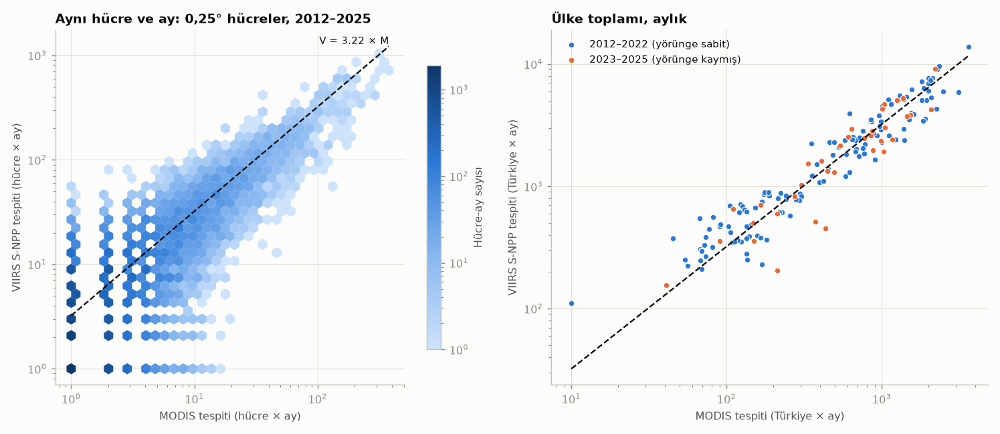

# Örtüşme dönemi analizi (adım 30)

Tarih: 14 Kasım 2026. Betik: `scripts/overlap.py --region turkiye`. Sayılar: `docs/overlap_stats.json`. Ara tablo: `data/processed/turkiye/overlap_cell_month.parquet`.
Girdi: `grid_daily.parquet` (Orta filtre). Dönem: 1 Şubat 2012 – 31 Aralık 2025, MODIS (Terra + Aqua) ile VIIRS S-NPP. Kesinti günleri (`docs/data_gaps.md`, 56 gün) iki sensörden de çıkarıldı.

## Özet
1. İki sensör aynı şeyi izliyor: aylık ülke toplamlarında uyum çok yüksek (korelasyon 0,92; logaritmik 0,95), hücre × yıl düzeyinde 0,93.
2. Genel oran **VIIRS = 3,22 × MODIS**. Yıldan yıla 2,95–3,59 arasında, belirgin bir eğilim yok.
3. Oran **aya göre çok değişiyor** (Haziran 2,0; Eylül 4,2) ve **gece gündüzün iki katı** (5,4'e karşı 2,8). Katsayı en az ay bazında olmalı.
4. Eşleştirme (ikinci kanıt): MODIS'in gördüğü yerlerin çoğunu VIIRS de görüyor (Aqua'da %57, gece %88); VIIRS'in gördüklerinin yalnızca dörtte birini MODIS görüyor. Yani VIIRS, MODIS'in gördüğünü kapsayan daha geniş bir küme: MODIS'i yukarı ölçeklemek doğru yön.
5. Yörünge kayması eşleşmede görünüyor (Aqua %60 → %40), ama sayı oranını 2025'e kadar belirgin değiştirmemiş.

## 1. Aynı hücre ve aylar

| | Değer |
|---|---|
| MODIS toplam | 122 476 |
| VIIRS S-NPP toplam | 394 864 |
| Toplamların oranı | 3,22 |
| Hücre-ay sayısı (en az bir sensörde tespit) | 59 318 |
| İkisinde de tespit olan | 19 413 |
| Yalnızca VIIRS'te tespit olan | 33 732 |
| Yalnızca MODIS'te tespit olan | 6 173 |

- Hücre-ay düzeyinde saçılma geniş (logaritmik korelasyon 0,73): tek bir hücrenin tek bir ayı için tahmin kabadır. Toplandıkça uyum hızla artıyor (hücre × yıl 0,93; ülke × ay 0,95).
- **VIIRS tespitlerinin %20,6'sı, o ay MODIS'in hiç tespit vermediği hücrelerde.** Bunlar MODIS'in göremediği küçük yangınlar. Katsayı toplamlardan hesaplandığı için bölge toplamı doğru çıkar, ama MODIS'ten tahmin edilen dönemde (2012 öncesi) harita, yangını gerçekte olduğundan biraz daha az hücreye toplar.

### Yıllara göre oran
| 2012 | 2013 | 2014 | 2015 | 2016 | 2017 | 2018 | 2019 | 2020 | 2021 | 2022 | 2023 | 2024 | 2025 |
|---|---|---|---|---|---|---|---|---|---|---|---|---|---|
| 3,46 | 3,37 | 3,32 | 3,00 | 3,32 | 3,30 | 3,19 | 3,48 | 3,59 | 2,98 | 2,95 | 3,23 | 3,13 | 3,01 |

- Adım 28'de görülen "2021 sonrası düşüş" kesinti günleri çıkarılınca küçülüyor (2024: 2,97 → 3,13). 2012–2022 ortalaması 3,25, 2023–2025 ortalaması 3,13.
- En düşük yıllar 2015, 2021, 2022: 2015 ve 2021 büyük yangın yılları (büyük yangını MODIS de görür, oran düşer).

### Aylara göre oran (toplamların oranı)
| Ay | Oca | Şub | Mar | Nis | May | Haz | Tem | Ağu | Eyl | Eki | Kas | Ara |
|---|---|---|---|---|---|---|---|---|---|---|---|---|
| 2012–2025 | 3,26 | 3,19 | 3,84 | 4,27 | 2,12 | 2,02 | 2,98 | 3,88 | 4,20 | 3,78 | 2,62 | 3,18 |
| 2012–2022 | 3,31 | 3,24 | 3,73 | 4,48 | 2,69 | 1,98 | 3,16 | 3,91 | 4,16 | 3,69 | 2,62 | 3,13 |
| 2023–2025 | 3,20 | 3,10 | 4,20 | 3,43 | 1,15 | 2,16 | 2,43 | 3,75 | 4,47 | 4,08 | 2,62 | 3,33 |

Haziran (hasat yangınları: büyük, gündüz) en düşük; Eylül (anız: küçük, akşam ve gece) en yüksek. Tek bir sabit katsayı Haziran'ı %60 fazla, Eylül'ü %25 eksik tahmin ederdi.

### Gündüz ve gece
| | Oran | MODIS'teki pay | VIIRS'teki pay |
|---|---|---|---|
| Gündüz | 2,75 | %82 | %70 |
| Gece | 5,38 | %18 | %30 |

Gece VIIRS çok daha duyarlı. Gece payı yıldan yıla değiştiği için (2009–2011'de %21, sonraki yoğun yıllarda %14) gündüz ve gece için ayrı katsayı adım 31'de sınanacak.

### Alt bölgelere göre
| Güneydoğu | İç Anadolu | Çukurova | Ege-Akdeniz kıyısı | Diğer |
|---|---|---|---|---|
| 2,78 | 3,40 | 3,69 | 3,53 | 3,57 |

Güneydoğu belirgin düşük. Alt bölge katsayısının tahmini iyileştirip iyileştirmediği adım 31'de sınanacak.

## 2. Tespit eşleştirme (ikinci kanıt)
Yöntem: Bir tespitin "eşi var" sayılması için, karşı sensörün **aynı geçiş döneminde** (aynı günün gündüzü ya da aynı gece) ve **R km içinde** en az bir tespiti olmalı. 122 476 MODIS ve 394 864 VIIRS tespiti.

| Yarıçap | VIIRS eşi olan MODIS | Aqua | Terra | MODIS eşi olan VIIRS |
|---|---|---|---|---|
| 1 km | %35,1 | %45,7 | %24,1 | %20,6 |
| 2 km | %44,8 | %56,6 | %32,7 | %26,5 |
| 3 km | %49,0 | %60,4 | %37,3 | %29,4 |

2 km yarıçapta ayrıntı:

| | Aqua | Terra | MODIS eşi olan VIIRS |
|---|---|---|---|
| Gündüz | %53,9 | %29,0 | %26,5 |
| Gece | %88,4 | %41,9 | %26,6 |
| 2012–2022 | %60,3 | %34,4 | %27,5 |
| 2023–2025 | %44,4 | %25,4 | %22,9 |

Yorum:
- **Aqua ile S-NPP aynı saatte geçer** (ikisi de yerel ~13:30 ve ~01:30). Aynı saatte bakıldığında MODIS'in gördüğünü VIIRS de büyük oranda görüyor: gündüz %54, gece %88. Gündüz eşleşmeyenlerin çoğu kısa süren tarla yangınları (geçişler arasındaki dakikalar içinde sönüyor ya da başlıyor).
- **Terra sabah geçer** (S-NPP'den ~2 saat önce), bu yüzden eşleşme düşük: farklı saatte farklı yangınlar. Terra'nın tespitleri VIIRS'in hiç görmediği bir saat dilimini temsil ediyor; MODIS sayısının yalnızca bir kısmı VIIRS ile "aynı yangın".
- **Ters yönde:** VIIRS tespitlerinin yalnızca dörtte birinin MODIS eşi var. VIIRS'in fazlası, MODIS'in çözünürlüğünün altında kalan küçük yangınlar.
- İki kanıt birbirini tutuyor: sayı oranı 3,2, eşleşme oranından beklenen de aynı büyüklükte (VIIRS'in ~%27'si MODIS'te görünüyor → yaklaşık 3,7 kat; bir MODIS pikseline birden çok VIIRS pikseli düştüğü için birebir eşit olması beklenmez).

### Yörünge kayması
Aqua'nın VIIRS ile eşleşme oranı yıllara göre (2 km):

| 2012 | 2013 | 2014 | 2015 | 2016 | 2017 | 2018 | 2019 | 2020 | 2021 | 2022 | 2023 | 2024 | 2025 |
|---|---|---|---|---|---|---|---|---|---|---|---|---|---|
| 60 | 63 | 60 | 65 | 64 | 60 | 55 | 55 | 57 | 64 | 47 | 49 | 45 | 40 |

- Gündüz geçiş saati (Haziran–Ekim medyanı, UTC): Aqua 2012–2022'de 10,6–10,9; 2023'te 11,0; 2024'te 11,4; 2025'te 12,0; 2026'da 12,8. Terra 2012–2022'de 8,5–8,7; 2023'te 8,3; 2024'te 7,8; 2025'te 7,8; 2026'da 7,2. **Kayma 2023'te başlıyor.**
- Eşleşme 2022'den itibaren düşüyor (2022 çok sakin bir yıl ve S-NPP kesintisi var; 2023 sonrası düşüş kaymayla uyumlu): Aqua artık S-NPP ile aynı saatte bakmıyor.
- Sayı oranı ise 2023–2025'te henüz belirgin değişmedi (3,13'e karşı 3,25). Ay bazında fark var (Mayıs, Temmuz düşük; Mart, Ekim yüksek) ama üç yıllık veri bunu kaymaya bağlamaya yetmez.

## 3. Adım 31 için sonuçlar
- **Kalibrasyon dönemi: 2012–2022** (iki MODIS uydusunun da geçiş saati sabit). MODIS'ten tahmin edilecek dönem (2002–2011) de sabit yörünge dönemi; kaymış yılları katsayıya katmak yanlış olur. 2023–2025 bağımsız sınama olarak kullanılacak.
- Katsayı **ay bazında** olmalı. Gündüz/gece ve alt bölge ayrımı, bir yılı dışarıda bırakarak yapılan sınamayla denenecek; tahmini iyileştirmiyorsa eklenmeyecek.
- Yöntem doğrusal kalmalı (hücreler toplanınca bölge toplamını vermeli). Bedeli: MODIS'in sıfır gösterdiği hücreler sıfır kalır.
