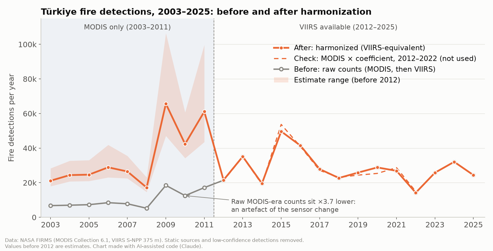
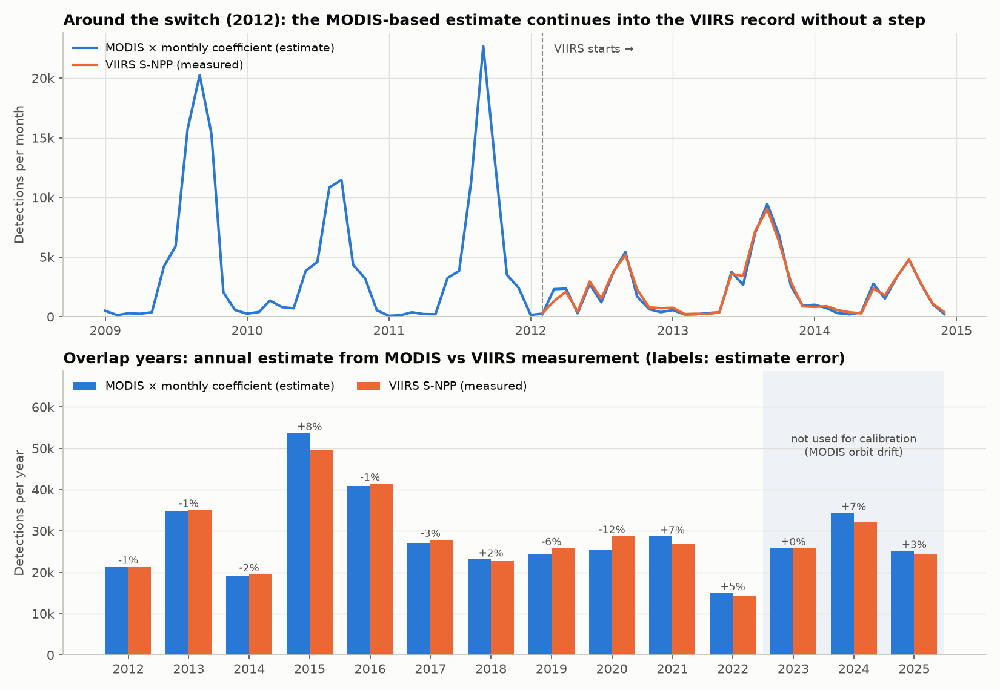

# Doğrulama (adım 32)

Tarih: 14 Kasım 2026. Betik: `scripts/validate.py --region turkiye`. Sayılar: `docs/validation_stats.json`. Girdi: `harmonized_monthly.csv`, `coefficients.json` (adım 31).

## Önce / sonra (demo grafiği)

Dosya: `docs/harmonized_before_after.png` (İngilizce, demo için). Gri çizgi uyumlaştırma olmadan iki sensörün ham sayılarını art arda koyuyor (2011'e kadar MODIS, 2012'den itibaren VIIRS); turuncu çizgi uyumlu seri. 2012'den sonra iki çizgi aynı (VIIRS'e dokunulmuyor).

| Yıllık medyan | 2003–2011 | 2012–2025 | Sonrası / öncesi |
|---|---|---|---|
| Ham birleşik seri | 7 816 | 26 362 | **3,37 kat** |
| Uyumlu seri | 26 493 | 26 362 | **1,00 kat** |
| Yalnızca MODIS (kendi içinde) | | | 1,03 kat |

- Ham birleşik seride 2012 öncesi düzey 3,4 kat düşük görünüyor; yangınlar 2012'de üç katına çıkmış gibi. Bu, sensör değişiminin yarattığı yapay bir basamak. Uyumlu seride basamak yok.
- Olağan dışı 2009–2011 yılları dışarıda bırakılırsa sonuç aynı: ham seride 3,69 kat, uyumlu seride 1,07 kat, MODIS'in kendi içinde 1,13 kat.
- Grafikte gölgeli bant, 2012 öncesi tahminlerin belirsizlik aralığı (adım 31). 2009 ve 2011'de bant çok geniş: bu yıllar sınanmış aralığın dışında ve büyük olasılıkla fazla tahmin.

**Dikkat:** Uyumlu serinin öncesi/sonrası oranının MODIS'inkine yakın çıkması yöntemin doğal sonucu (MODIS sabit sayılarla çarpılıyor), bağımsız bir kanıt değil. Bağımsız kanıt aşağıdaki iki sınama.

## Geçiş yılında (2012) kopukluk var mı? Hayır

1. **Kavşak sınaması.** 2012'nin katsayısı 2012 verisi hiç kullanılmadan (yalnızca 2013–2022'den) hesaplandığında, MODIS'ten tahmin edilen 2012 Şubat–Aralık toplamı 21 602, VIIRS'in ölçtüğü 21 389: fark **+%1,0**. Yani MODIS tahmininden VIIRS ölçümüne geçilen noktada iki kaynak aynı değeri veriyor.
2. **2011 → 2012 değişimi.** MODIS'in kendi sayısı −%63,7 düşüyor; uyumlu seri −%64,8. Ham birleşik seri ise +%25,0 artış gösteriyor (yön bile yanlış). 2011'den 2012'ye görülen büyük düşüş gerçek (2011 çok yoğun bir anız yakma yılı), sensör değişiminden kaynaklanmıyor.
3. **Örtüşme dönemi boyunca.** MODIS × katsayı tahmini ile VIIRS ölçümü 2012–2025'te aylık bazda neredeyse üst üste (korelasyon 0,985). Yıllık fark −%12 ile +%8 arasında; katsayıya hiç girmeyen 2023–2025'te %0, +%7, +%3 (2024'teki farkın bir kısmı VIIRS'in o yılki 20 günlük kesintisinden).

## Yorum
Uyumlu seride 2012'de kopukluk yok: iki kaynağın buluştuğu yılda tahmin ile ölçüm %1 içinde örtüşüyor ve 2011'den 2012'ye geçiş MODIS'in kendi gösterdiği değişimi izliyor. Uyumlaştırma, ham seride görünen "2012'de yangınlar üç katına çıktı" yanılsamasını gideriyor; 2003–2011 ile 2012–2025'in olağan düzeyi artık aynı. Seri, tek tek aylar için ±%15–35, yıllık toplamlar için yaklaşık ±%5–11 belirsizlik taşıyor; 2009 ve 2011 bunun dışında, o yılların değeri bir üst sınır gibi okunmalı.

## Sınırlamalar (Yöntem bölümüne girecek, adım 59)
- 2012 öncesi değerler ölçüm değil, MODIS'ten tahmindir.
- Yoğun aylarda tahmin %6–15 fazla, sakin aylarda eksik kalır; 2009 ve 2011 Ağustos–Ekim sınanmış aralığın dışındadır.
- Tek bir hücrenin tek bir ayı için tahmin kabadır; MODIS'in sıfır gösterdiği hücre sıfır kalır.
- Mevsim biçimi 2012 öncesinde biraz farklı görünür (Eylül'ün payı 2003–2008'de %32, VIIRS döneminde %20; Kasım ve kış aylarının payı daha düşük). Bunun ne kadarı gerçek değişim, ne kadarı yöntemin sınırı, bu veriyle ayrılamaz.
- Sayılar "tespit edilen yangın pikseli"dir, yangın sayısı değildir.
