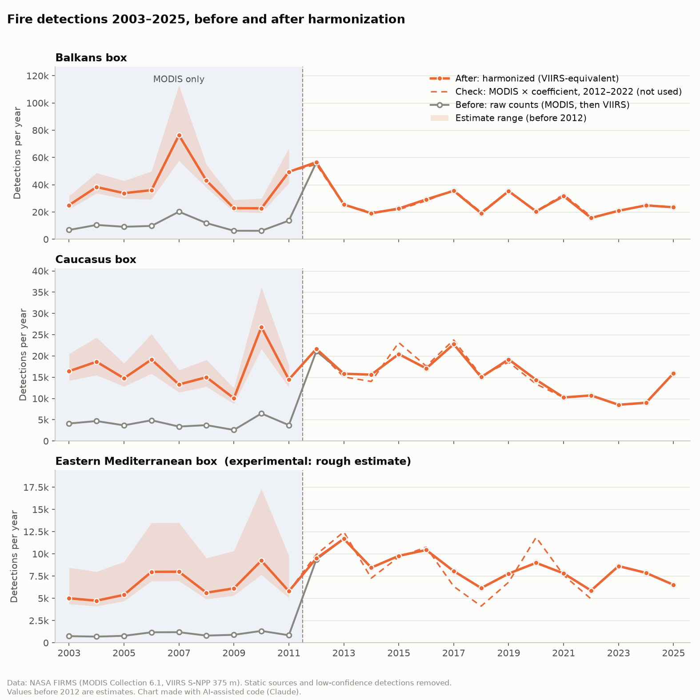

# Seviye 2: doğrulama (adım 50)

Betik: `scripts/validate_s2.py`. Sayılar: `docs/validation_s2_stats.json`. Girdi: her bölgenin `harmonized_monthly.csv` ve `harmonize_stats_<bölge>.json` dosyaları. Yöntem ve kararlar: `docs/harmonize_s2.md`.

## Önce / sonra

Gri: uyumlaştırma olmadan ham sayılar (2011'e kadar MODIS, 2012'den itibaren VIIRS). Turuncu: uyumlu seri. Gölge: 2012 öncesi tahminlerin aralığı.

## Sınama sonuçları

| | Balkanlar | Kafkasya | Doğu Akdeniz | Türkiye |
|---|---|---|---|---|
| Aylık hata (bir yıl dışarıda, ağırlıklı) | %8,7 | %12,0 | %23,7 | %11,8 |
| Yıllık hata, ortalama | %3,1 | %5,5 | %15,4 | %4,6 |
| Yıllık hata, en kötü yıl | %5,2 | %16,6 (2015) | %43,6 (2020) | %11,3 |
| 2023–2025 bağımsız sınama, toplam | +%3,8 | +%0,7 | +%18,7 | +%1,5 |
| 2023 / 2024 / 2025 | +%11,6 / −%0,5 / +%1,3 | +%3,6 / +%3,7 / −%2,6 | +%8,4 / +%3,1 / +%51,1 | +%0,2 / +%1,8 / +%2,6 |
| MODIS tahmini ile VIIRS, aylık korelasyon (2012–2025) | 0,990 | 0,982 | 0,914 | 0,985 |

## Geçiş yılı (2012)

| | Balkanlar | Kafkasya | Doğu Akdeniz | Türkiye |
|---|---|---|---|---|
| Kavşak: 2012 dışarıda bırakılarak MODIS'ten tahmin, VIIRS ölçümüne göre | −%3,1 | %0,0 | +%6,7 | +%1,0 |
| 2011 → 2012 değişimi: MODIS'in kendisi | +%10 | +%51 | +%71 | −%64 |
| 2011 → 2012 değişimi: uyumlu seri | +%14 | +%50 | +%64 | −%65 |
| 2011 → 2012 değişimi: ham birleşik seri | +%312 | +%466 | +%1 007 | +%25 |
| Düzey oranı (2012–2025 medyanı / 2003–2011 medyanı): ham birleşik | 2,47 | 4,21 | 9,77 | 3,37 |
| Düzey oranı: uyumlu seri | 0,67 | 1,05 | 1,42 | 1,00 |
| Düzey oranı: MODIS'in kendi içinde | 0,70 | 1,05 | 1,57 | 1,03 |

- Üç bölgede de ham seride 2012'de 4–11 katlık yapay bir sıçrama var (Türkiye'den çok daha belirgin, çünkü Türkiye'de 2011 olağan dışı yoğun bir yıldı). Uyumlu seride sıçrama yok: 2011'den 2012'ye değişim MODIS'in kendi gösterdiğini izliyor.
- Kavşak sınaması Balkanlar ve Kafkasya'da Türkiye düzeyinde (−%3 ve %0). Doğu Akdeniz'de +%6,7.
- Balkanlar'da uyumlu serinin 2012 sonrası düzeyi öncesinin 0,67 katı: MODIS'in kendi içinde de 0,70. Bu gerçek bir azalma (2003–2011'de 2007 gibi çok yoğun yıllar var), yöntemin ürünü değil.

## Yorum
- **Balkanlar:** Sınama Türkiye'den iyi; en zayıf nokta 2023 (+%11,6). 2012'de kopukluk yok.
- **Kafkasya:** Türkiye ile aynı düzeyde; 2015'te +%16,6, 2014'te −%11,5. 2012'de kopukluk yok.
- **Doğu Akdeniz:** Türkiye'nin 2–3 katı hata. VIIRS/MODIS oranı yıldan yıla 4,6 ile 10,3 arasında oynuyor; hiçbir katsayı seçeneği bunu yakalamıyor. Oranın düştüğü yıllar (2020: 5,0; 2025: 4,6) MODIS sayısının yaz aylarında olağan dışı yükseldiği yıllar; büyük orman yangınlarının MODIS'te de görünmesiyle uyumlu, ama bu veriyle kanıtlanmadı. 2012 öncesi değerler kaba tahmindir.

## Kısıtlar
- 2012 öncesi tüm değerler ölçüm değil, MODIS'ten tahmindir.
- Doğu Akdeniz'de MODIS çok az (2002–2011 toplamı 8 980 tespit; Türkiye'de 95 984): tek tek aylar için tahmin ±%13 ile +%69 arasında oynayabilir, yoğun aylarda fazla (gerçek / tahmin 0,65), sakin aylarda eksik (1,5) kalır.
- Doğu Akdeniz'de filtreden geçen VIIRS tespitlerinin yaklaşık %15'i büyük olasılıkla etiketlenmemiş sanayi kaynağı (`docs/harmonize_s2.md` madde 1). Bu, 2012 sonrası ölçüm değerlerini de bir miktar şişirir.
- Kutular Türkiye ile kesişir; Türkiye toprakları için Türkiye görünümü geçerlidir (`docs/harmonize_s2.md` madde 6).
- Kutu bölgeleri kara maskesiyle (deniz hariç), Türkiye ülke sınırıyla kesilmiştir; kutu toplamları ülke toplamı değildir.
- Sınanmış aralığın dışındaki aylar (Balkanlar 2007 yazı, Kafkasya ve Doğu Akdeniz 2010 Kasım–Aralık) büyük olasılıkla fazla tahmindir.
