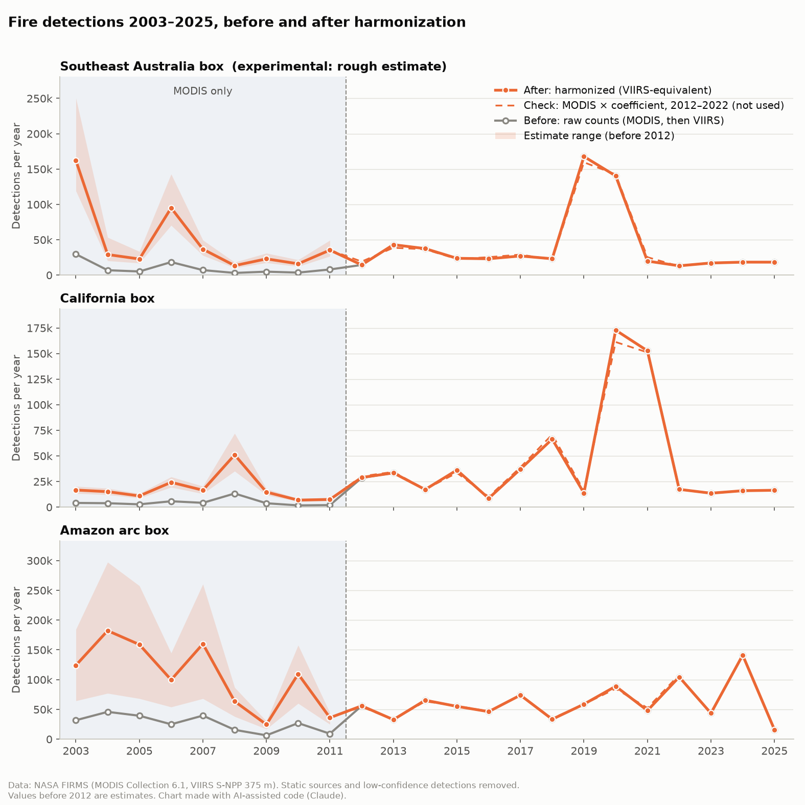

# Biyom kutuları: doğrulama (adım 81)

Tarih: 15 Kasım 2026. Betik: `scripts/validate_s2.py --tag s3 se_australia california amazon_arc`. Sayılar: `docs/validation_s3_stats.json`, `docs/harmonize_stats_<kutu>.json`. Kararlar: `docs/harmonize_s3.md`.

## Önce / sonra

Gri: ham sayılar (2011'e kadar MODIS, 2012'den itibaren VIIRS). Turuncu: uyumlu seri. Gölge: 2012 öncesi tahmin aralığı.

## Sınama sonuçları

| | Güneydoğu Avustralya | Kaliforniya | Amazon yayı | Türkiye |
|---|---|---|---|---|
| Aylık hata (bir yıl dışarıda, ağırlıklı) | %14,6 | %10,2 | %6,8 | %11,8 |
| Yıllık hata, ortalama | %12,1 | %7,3 | %2,5 | %4,6 |
| Yıllık hata, en kötü yıl | %36,0 (2012) | %18,4 (2016) | %10,0 (2021) | %11,3 |
| 2023–2025 bağımsız sınama, toplam | +%8,2 | %0,0 | −%0,3 | +%1,5 |
| 2023 / 2024 / 2025 | +%16,6 / +%8,2 / +%0,4 | +%7,1 / +%1,4 / −%7,2 | +%6,5 / −%3,4 / +%8,4 | +%0,2 / +%1,8 / +%2,6 |
| MODIS tahmini ile VIIRS, aylık korelasyon | 0,998 | 0,996 | 0,997 | 0,985 |
| Karar | deneysel | normal | normal | |

## Geçiş yılı (2012)

| | Güneydoğu Avustralya | Kaliforniya | Amazon yayı | Türkiye |
|---|---|---|---|---|
| Kavşak: 2012 dışarıda bırakılarak MODIS'ten tahmin, VIIRS ölçümüne göre | **+%36,0** | +%4,1 | −%3,3 | +%1,0 |
| 2011 → 2012: MODIS'in kendisi | −%46 | +%251 | +%50 | −%64 |
| 2011 → 2012: uyumlu seri | −%59 | +%285 | +%55 | −%65 |
| 2011 → 2012: ham birleşik seri | +%80 | +%1 329 | +%509 | +%25 |
| Düzey oranı (2012–2025 / 2003–2011 medyanı): ham birleşik | 3,35 | 5,97 | 2,06 | 3,37 |
| Düzey oranı: uyumlu seri | 0,80 | 1,53 | 0,51 | 1,00 |
| Düzey oranı: MODIS'in kendi içinde | 0,78 | 1,72 | 0,53 | 1,03 |

- Kaliforniya ve Amazon'da 2012'de kopukluk yok: kavşak farkı %4 ve %3, uyumlu serinin 2011 → 2012 değişimi MODIS'inkini izliyor.
- **Avustralya'da kavşak tutmuyor (+%36):** 2012 sakin bir yıl ve sakin yıllarda yöntem fazla tahmin ediyor. 2011'den 2012'ye uyumlu seri −%59 düşerken MODIS −%46 düşüyor; aradaki fark, 2011 değerinin (35 394) fazla tahmin edilmiş olmasından. Bölgenin "deneysel" olmasının nedeni bu.
- Düzey oranları ham seride 2–6 kat yapay sıçrama gösteriyor; uyumlu seride MODIS'in kendi oranıyla aynı. Amazon'da 2012 sonrası düzeyin yarıya inmesi gerçek (2003–2007 çok yoğun yıllar).

## Avustralya: büyük yangın yılları (2019–20) hatayı sivriltiyor mu? Hayır
| | Sınama hatası |
|---|---|
| 2019 (167 734 tespit) | +%3,1 |
| 2020 (140 259 tespit) | +%5,8 |
| 2012 (14 415 tespit) | +%36,0 |
| 2021 (19 859 tespit) | +%32,8 |
| Diğer yedi yıl | −%12,5 … +%10,7 |

- Büyük yangın yılları en iyi tahmin edilen yıllar. Hata **sakin yıllarda** büyüyor: VIIRS/MODIS oranı yoğun yıllarda 5,4–5,9, sakin yıllarda 3,3–3,4. Büyük orman yangınları VIIRS'te MODIS'e göre çok daha fazla piksel üretiyor.
- 2019–2020, kalibrasyon dönemindeki MODIS tespitlerinin %52'si. Buna rağmen katsayıları belirlemiyor: bu iki yıl çıkarılıp katsayı yeniden hesaplandığında 2002–2011 toplamı yalnızca %0,3 değişiyor, yıllık hata ortalaması %12,1'den %14,4'e çıkıyor (iyileşmiyor), 2023–2025 sapması +%8,2'den +%4,5'e iniyor.
- Sonuç: sorun tek bir olağan dışı mevsim değil, oranın etkinlik düzeyine bağlı olması. Aylık tek katsayı bunu yakalayamıyor; yöntem değiştirilmedi, bölge deneysel olarak işaretlendi. 2003 (162 107) ve 2006 (95 106) gibi yoğun yıllar güvenilir, aradaki sakin yıllar yaklaşık üçte bire kadar fazla tahmin edilmiş olabilir.

## Amazon: 2 429 sabit hücre yangın ayrımını bozuyor mu?
İki ayrı soru var.

### a) Güncel veride kullanılan konum maskesi (2 429 hücre): etkisi ihmal edilebilir
- Maske yalnızca `type` alanı olmayan güncel (NRT, Ağustos 2026 sonrası) veriye uygulanıyor. 2026'da VIIRS tespitlerinin %0,2–0,8'ini, MODIS'in %1,6–7,7'sini çıkarıyor. Seri 2012'den sonra VIIRS'ten geldiği için etkisi %1'in altında.
- Maskenin burada ne kadar işe yaradığı belirsiz: 2023'e kadarki veriyle kurulup 2024'te sınandığında o yılın sabit kaynak işaretli VIIRS tespitlerinin yalnızca %10'unu yakalıyor (228 tespit), 2024'e kadarki veriyle kurulup 2025'te sınandığında %90'ını (74 tespit). Sayılar çok küçük; Türkiye'de aynı sınama %95–97 veriyordu. Yanlışlıkla çıkarılan yangın payı VIIRS'te %0,4–1,9, MODIS'te %2,8–6,3.

### b) Arşivdeki sabit kaynak işaretleri: MODIS'te şüpheli, 2003–2004'ü etkiliyor
| | MODIS | VIIRS S-NPP |
|---|---|---|
| Sabit kaynak işaretli tespit | 29 463 (%5,2) | 1 195 (%0,1) |
| Mevsimsellik (en yoğun ay / ortalama) | 3,2 (Haziran–Temmuz tepesi) | |
| Yıl boyu kalıcı hücrede olanlar | %10,6 | %94 |
| FRP medyanı | 24,8 MW (yangınlarda 24,1) | 1,3 MW |

- 2 429 hücrenin kaynağı neredeyse tümüyle **MODIS**. VIIRS aynı bölgede neredeyse hiç sabit kaynak işaretlemiyor.
- MODIS'in işaretledikleri gerçek sabit kaynak profiline uymuyor: mevsimlik (diğer bölgelerde sabit kaynaklar yıl boyu düz), yıl boyu kalıcı değil, güçleri yangınlarla aynı. Kuru mevsimin başında aynı yerde günlerce süren yakmalarla (örneğin açılan arazide yığın yakma) uyumlu; bu bir çıkarım, bu veriyle kanıtlanamaz.
- Yıllara dağılım çok dengesiz: tutulan MODIS tespitlerine oranla **2003'te %16,6, 2004'te %24,6**, 2018'de %9,5, diğer yıllarda %0–6.
- **Etki:** Bunlar gerçek yangınsa, Amazon'un 2003 ve 2004 değerleri yaklaşık %14–20 eksik. Kalibrasyon dönemini (2012–2022, ortalama %2) ve dolayısıyla katsayıları belirgin etkilemiyor; sınama sonuçları geçerli.
- Onaylı filtre (adım 28) değiştirilmedi. Sayfanın Hakkında bölümüne not düşüldü. İstenirse Amazon için MODIS sabit kaynak işaretini yok sayan bir seçenek sonraki iş olarak eklenebilir.

### Diğer iki kutu
- Avustralya ve Kaliforniya'da VIIRS sabit kaynakları gerçek profile uyuyor (yıl boyu düz, %99'u kalıcı hücrelerde, Kaliforniya'da %99,9'u gece). Yanlışlıkla elenen yangın bulunmadı (kalıcı olmayan hücrede 1 ve 3 tespit).
- Filtreden geçip kalıcı hücrede kalan (etiketlenmemiş sanayi olabilecek) VIIRS payı üç kutuda da %0,1–0,4; Doğu Akdeniz'deki sorun (%15) burada yok.

## Kısıtlar
- 2012 öncesi tüm değerler MODIS'ten tahmindir.
- Güneydoğu Avustralya: sakin yıllarda yaklaşık üçte bire kadar fazla tahmin.
- Amazon yayı: 2003–2004 yaklaşık %14–20 eksik olabilir; 2002–2007 kuru mevsimlerinin çoğu sınanmış aralığın dışında (geniş aralık).
- Kaliforniya: Haziran 2008 sınanmış en yüksek düzeyin 8 katı; o ayın tahmini (12 603, aralık 8 066–18 778) çok belirsiz.
- Kasım 2026 sonrası değerler ortak NOAA-20 çarpanı nedeniyle Avustralya'da yaklaşık %5, Amazon'da %3,5 düşük olabilir.
- Kutular 5° × 5°'lik örnek alanlardır; ülke ya da biyom toplamı değildir.
